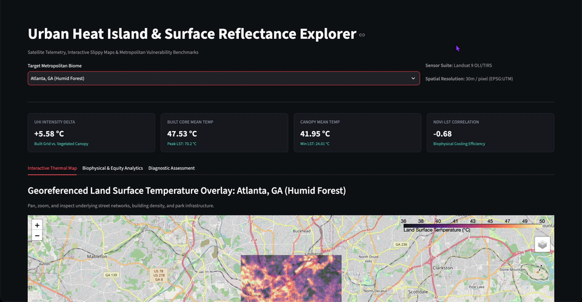

# Urban Heat Island (UHI) & Surface Reflectance Explorer



An interactive geospatial analytics dashboard and multimodal LLM diagnostic tool for urban microclimate analysis. Built with Streamlit, Rasterio, Folium, and Google Gemini, the application pulls Landsat 8/9 Level-2 (Collection 2) imagery directly from Microsoft Planetary Computer to analyze surface temperature anomalies across four distinct metropolitan biomes.

---

## Overview

Urban Heat Islands are traditionally evaluated using sparse weather stations or static maps. This project processes 30-meter multispectral satellite rasters on the fly to compute Land Surface Temperature (LST) and vegetative health (NDVI/NDBI), then pairs the spatial data with multimodal LLMs to identify microclimate risks and cooling disparities.

### Key Capabilities
- **Direct STAC Streaming:** Queries Microsoft Planetary Computer, reprojects WGS84 bounding boxes to native UTM coordinates, and streams windowed GeoTIFFs without downloading full multi-gigabyte scenes.
- **Radiometric Calibration:** Converts raw Digital Numbers (DN) to Bottom-of-Atmosphere (BOA) surface reflectance and inverts thermal infrared emissions to Land Surface Temperature in Celsius.
- **Biome-Aware Segmentation:** Couples NDBI and NDVI thresholds to decouple impervious surfaces from bare soil, preventing rural desert from skewing urban baseline metrics in arid climates.
- **Georeferenced Slippy Maps:** Displays water-masked thermal overlays on dark-canvas base layers using Folium, paired with interactive Plotly density distributions.
- **Multimodal Scene Diagnostics:** Passes visual false-color composites, thermal heatmaps, and calculated telemetry to Gemini with strict Pydantic schema validation.

---

## Sensor Physics & Radiometric Calibration

### 1. Optical Surface Reflectance (Bands 4, 5, 6)
Digital numbers from Landsat Level-2 surface reflectance products are calibrated to Bottom-of-Atmosphere (BOA) reflectance ($\rho$) using official USGS scaling parameters:
$$\rho = (DN \times 0.0000275) - 0.2$$

### 2. Land Surface Temperature (Band 10)
Thermal infrared measurements from TIRS-1 are converted from raw DN to Kelvin, then converted to Celsius:
$$T_K = (DN \times 0.00341802) + 149.0$$
$$T_{^\circ\text{C}} = T_K - 273.15$$

### 3. Spectral Indices
* **Normalized Difference Vegetation Index (NDVI):**
  $$NDVI = \frac{\rho_{\text{NIR}} - \rho_{\text{Red}}}{\rho_{\text{NIR}} + \rho_{\text{Red}}}$$
* **Normalized Difference Built-Up Index (NDBI):**
  $$NDBI = \frac{\rho_{\text{SWIR}} - \rho_{\text{NIR}}}{\rho_{\text{SWIR}} + \rho_{\text{NIR}}}$$

---

## Biome Comparison & Observations

The pipeline tests four metropolitan regions with contrasting physical and climatic profiles:

| Metropolitan Region | Biome Type | Typical Peak LST | Primary Heat Driver | Microclimate Observations |
|---|---|---|---|---|
| **Phoenix, AZ** | Subtropical Arid | $> 50^\circ\text{C}$ | High soil/pavement thermal mass | Irrigated suburban turf creates an "oasis effect" cooler than natural desert fringes. |
| **Atlanta, GA** | Humid Subtropical | $\sim 36–40^\circ\text{C}$ | Tree canopy removal along highways | Dense deciduous canopy provides strong regional cooling, but high humidity elevates human heat indices. |
| **Chicago, IL** | Temperate Lakefront | $\sim 38–42^\circ\text{C}$ | Inland impervious grid | Lake Michigan creates an abrupt thermal drop along the lakefront, while inland industrial corridors absorb high heat. |
| **New York, NY** | High-Density Coastal | $\sim 42–46^\circ\text{C}$ | Deep street canyons & asphalt | Central Park acts as an intense 4°C–6°C cooling sink surrounded by dense midtown concrete. |

---

## Engineering Notes & Technical Limitations

1. **LST vs. Air Temperature:** Satellites measure *radiant skin temperature* (Land Surface Temperature), not 2-meter ambient air temperature. While LST highlights solar radiation absorption on rooftops and roads, real human thermal comfort depends heavily on shade, wind flow, and relative humidity within the Canopy Air Layer (CAL).
2. **Arid Biome Classification:** Standard UHI workflows often define urban boundaries simply by looking for low NDVI ($< 0.2$). In Phoenix, dry desert soil also produces low NDVI and runs hotter than watered lawns. To fix this, the index pipeline requires a positive NDBI value ($> 0.0$) alongside low NDVI to confirm built infrastructure before computing urban heat deltas.
3. **Temporal Resolution:** Landsat has an 8- to 16-day revisit cycle. These scenes represent daytime summer snapshots under minimal cloud cover, rather than diurnal diurnal cycles (such as nighttime heat retention).

---

## Setup & Local Run

### Prerequisites
- Python 3.10+
- A Google Gemini API key

### 1. Clone & Install
```bash
git clone [https://github.com/your-username/urban-heat-explorer.git](https://github.com/your-username/urban-heat-explorer.git)
cd urban-heat-explorer

python3 -m venv venv
source venv/bin/activate
pip install -r requirements.txt
2. Environment Configuration
Create a .env file in the root directory:

Bash
echo 'GEMINI_API_KEY="your_api_key_here"' > .env
3. Ingest Satellite Rasters
Fetch the coordinate-bounded GeoTIFF crops for Phoenix, Atlanta, Chicago, and New York:

Bash
python3 download_real_scene.py
4. Run Dashboard
Bash
streamlit run app.py
Open http://localhost:8501 in your browser.

Project Structure
Plaintext
urban-heat-explorer/
├── app.py                  # Streamlit application entry point
├── download_real_scene.py  # STAC querying and UTM windowed ingestion
├── requirements.txt        # Pinned dependencies
├── src/
│   ├── ai_analyst.py       # Gemini API client with Pydantic structured output
│   ├── indices.py          # Radiometric calibration and index math (NDVI, NDBI, LST)
│   └── visualizer.py       # Map overlays, Folium configurations, and Plotly charts
└── data/
    ├── raw/                # Cached GeoTIFF bands (excluded from git)
    └── processed/          # Cached PNG previews